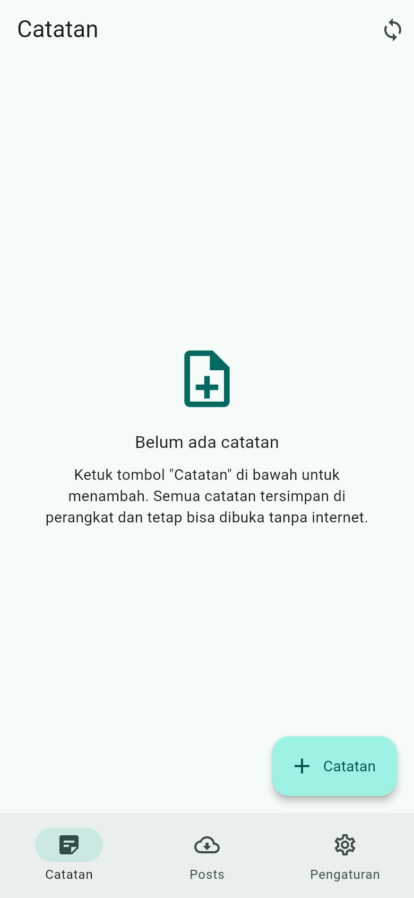
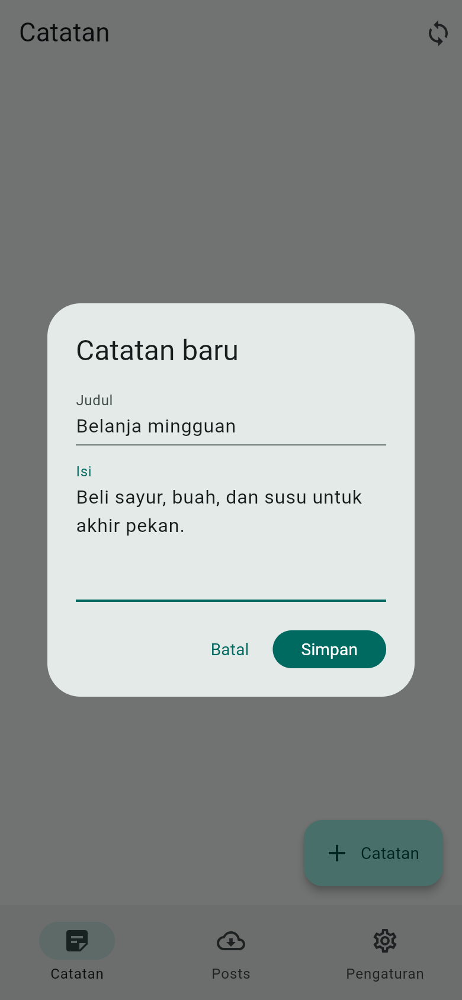
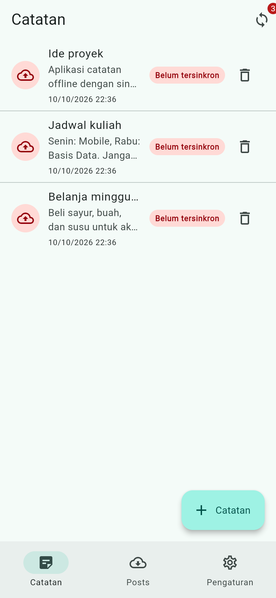
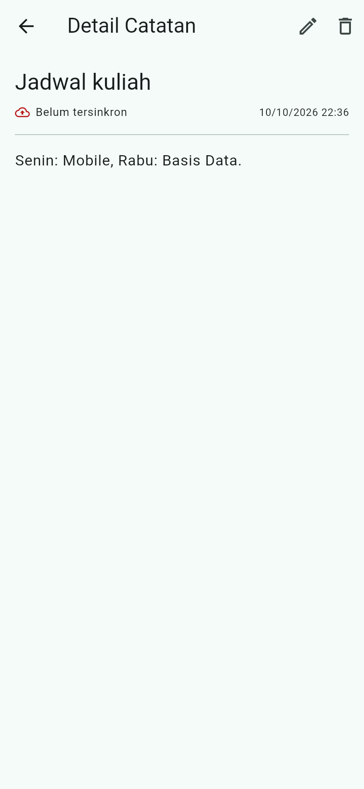
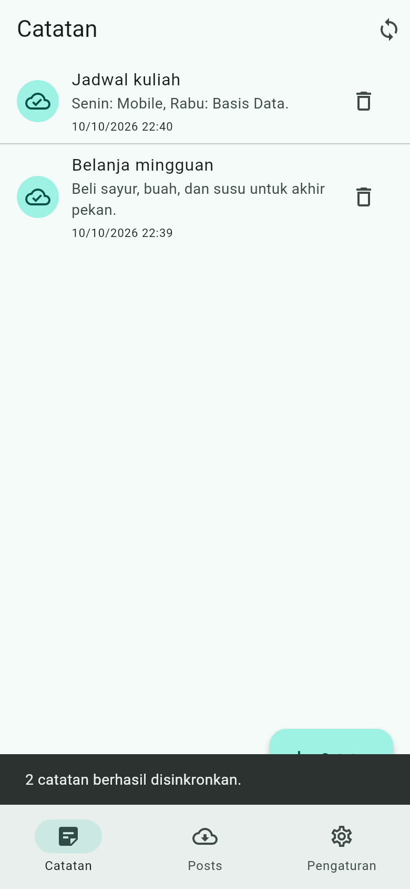
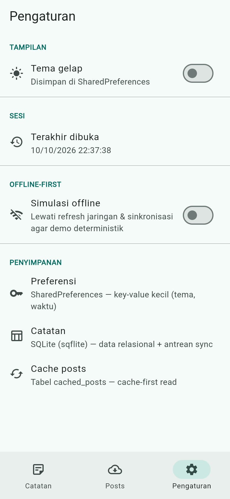
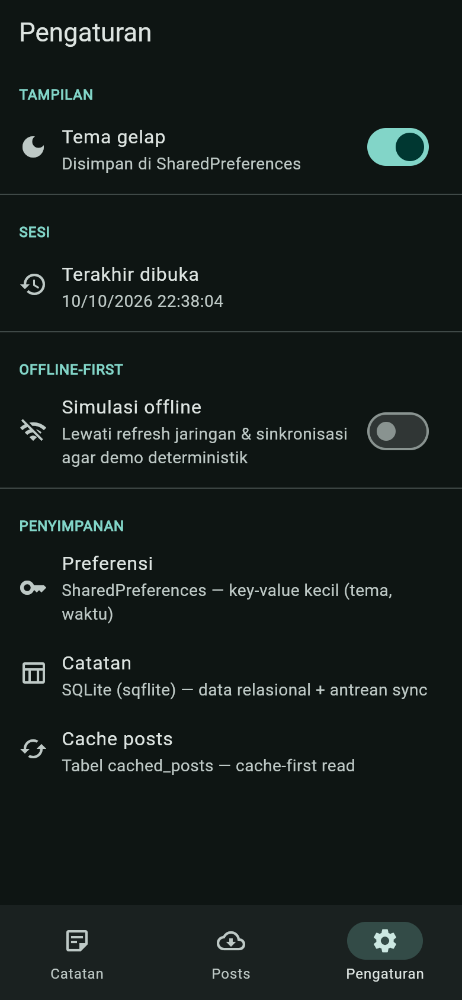
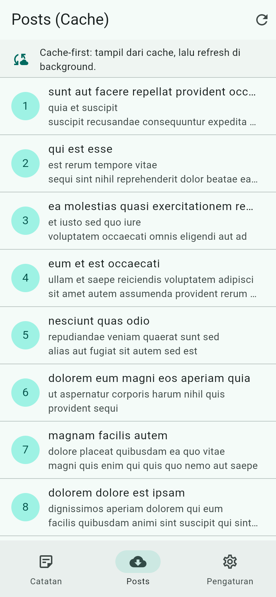
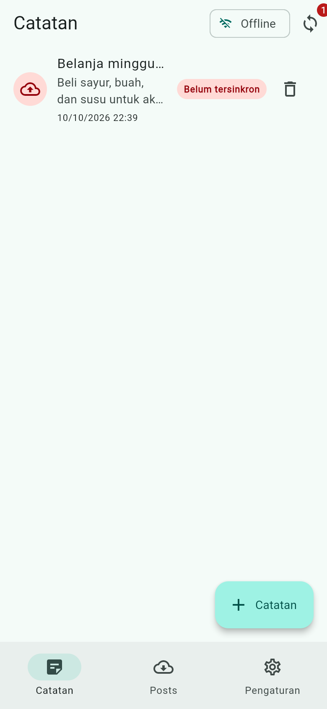

# Week 5 — Local Storage & Offline-First (Offline Notes)

Aplikasi Flutter **Offline Notes**: mencatat catatan secara persisten di
perangkat (SQLite) dengan preferensi tema (SharedPreferences) dan pola
**offline-first**. Dibuat mengikuti modul
[Codelab Minggu 5 — Local Storage & Offline First](https://jti-polinema.github.io/flutter-codelab/05-minggu-5-local-storage-offline-first/index.html).

| | |
|---|---|
| Nama | *(isi NIM/nama Anda)* |
| Mata Kuliah | Pemrograman Mobile |
| Program Studi | D4 Teknik Informatika — JTI Polinema |
| Data bacaan | [JSONPlaceholder](https://jsonplaceholder.typicode.com) (`/posts`) — hanya untuk demo cache-first |

## Tujuan

- Menjelaskan perbedaan penyimpanan key-value, relasional, dan NoSQL.
- Menyimpan preferensi (tema, terakhir dibuka) dengan **SharedPreferences**.
- Menerapkan **CRUD catatan** dengan **SQLite (sqflite)** lewat repository lokal.
- Menerapkan pola **offline-first**: cache-first read, dirty flag, dan antrean sinkronisasi.
- Menampilkan state **loading, error, empty, success** untuk data lokal dengan Riverpod.
- Menguji repository lokal dengan **repository palsu** (tanpa database sungguhan).

## Arsitektur

```
UI (ConsumerWidget)  --watch-->  Provider (AsyncValue)
Provider  --panggil-->  Repository  --CRUD-->  SQLite / SharedPreferences
Repository  --sync-->  Remote (simulasi)  --sukses-->  dirty = 0
Cache: baca lokal dulu, refresh background, simpan
```

Aturan yang dipegang: **UI tidak pernah memanggil SQLite/SharedPreferences
secara langsung.** Semua akses data lewat repository + provider.

## Fitur Utama

1. **Preferensi (SharedPreferences)** — tema gelap/terang dan waktu terakhir
   dibuka, terpusat di `PrefsRepository`.
2. **CRUD catatan (SQLite/sqflite)** — tambah, baca, ubah, hapus; daftar urut
   `updated_at DESC`; lewat `NoteRepository`.
3. **Dirty flag + antrean sync** — setiap perubahan lokal menandai `dirty = 1`;
   `syncNotes` menandai bersih hanya setelah "server" sukses.
4. **Cache-first read** — tabel `cached_posts` menampilkan data seketika, lalu
   refresh dari jaringan di background.
5. **Empat state UI** — loading, error (+ retry), empty, dan success.
6. **Simulasi offline deterministik** — toggle `forceOffline` agar demo tidak
   bergantung Wi-Fi.
7. **Halaman detail `/note/:id`** (GoRouter) — membaca dari repository lokal.
8. **11 test lulus** — model, provider palsu, logika sync, dan widget.

## Keputusan Storage (ringkas)

| Kebutuhan | Pilihan | Alasan |
|---|---|---|
| Preferensi (tema, waktu) | **SharedPreferences** | key-value primitif, tanpa adapter/init tambahan |
| Catatan (CRUD + sync) | **SQLite (sqflite)** | query terurut/filter, update parsial, kolom `dirty`/`updated_at` |
| Cache posts | **tabel `cached_posts` (SQLite)** | satu database untuk data lokal + cache |

Perbandingan lengkap SharedPreferences vs Hive vs sqflite vs Drift ada di
[`docs/AI_challenge/README.md`](docs/AI_challenge/README.md).

## Stack Teknologi

- Flutter 3.47 / Dart 3.13
- [`flutter_riverpod`](https://pub.dev/packages/flutter_riverpod) 3.x — `AsyncValue`, `AsyncNotifier`
- [`shared_preferences`](https://pub.dev/packages/shared_preferences) — key-value
- [`sqflite`](https://pub.dev/packages/sqflite) + [`path`](https://pub.dev/packages/path) — SQLite
- [`go_router`](https://pub.dev/packages/go_router) — navigasi
- [`dio`](https://pub.dev/packages/dio) — cache-first read (demo)
- `sqflite_common_ffi` / `sqflite_common_ffi_web` — **hanya** agar bisa demo di desktop/web

## Cara Menjalankan

```bash
flutter pub get
flutter run            # emulator Android / perangkat / desktop / web
flutter analyze        # pastikan tidak ada issue
flutter test           # pastikan semua test lulus
```

Untuk target **web** (opsional), siapkan binari sqlite3 sekali:

```bash
dart run sqflite_common_ffi_web:setup
```

Alur aplikasi: tab **Catatan** → tambah/edit/hapus → ketuk catatan → detail
`/note/:id`. Tab **Posts** mendemokan cache-first. Tab **Pengaturan** berisi
tema, waktu terakhir dibuka, dan toggle simulasi offline.

## Struktur Folder

```
lib/
├── main.dart                          # Entry point + ProviderScope + tema
├── app_router.dart                    # GoRouter (/ dan /note/:id)
├── data/
│   ├── api_client.dart                # Dio terpusat (cache-first)
│   ├── prefs.dart                     # PrefsRepository (SharedPreferences)
│   ├── providers.dart                 # Provider catatan/prefs/cache/sync
│   ├── sync.dart                      # Cache-first + syncNotes + exception
│   ├── local/
│   │   ├── db.dart                    # openNotesDb + skema
│   │   ├── note.dart                  # Model Note (dirty, updated_at)
│   │   ├── db_factory_io.dart         # factory native/desktop
│   │   ├── db_factory_web.dart        # factory web (wasm)
│   │   └── db_factory_stub.dart
│   ├── models/post.dart               # Model Post (cache-first)
│   └── repositories/
│       └── note_repository.dart       # CRUD + countDirty + markAllSynced
├── pages/
│   ├── home_page.dart                 # NavigationBar 3 tab
│   ├── notes_page.dart                # daftar catatan (4 state)
│   ├── note_detail_page.dart          # detail /note/:id
│   ├── cached_posts_page.dart         # cache-first read
│   └── settings_page.dart             # preferensi + simulasi offline
└── widgets/
    ├── note_tile.dart                 # baris catatan + badge dirty
    └── note_editor_dialog.dart        # dialog tambah/edit
test/
├── note_test.dart                     # model + provider palsu
├── sync_test.dart                     # logika offline-first
└── note_tile_test.dart                # widget
docs/
├── offline_first.md                   # strategi + aturan konflik
├── refactoring.md                     # Refactoring Challenge
└── AI_challenge/                      # prompt, output AI, checklist
screenshots/                           # tangkapan layar (layout mobile)
README.md
```

## Hasil / Screenshot

Semua tangkapan layar diambil pada viewport mobile (390×844).

### Layar kosong (empty state)


### Dialog tambah catatan


### Daftar catatan — badge "Belum tersinkron" & antrean sync (3)


### Detail catatan `/note/:id`


### Setelah sinkronisasi — badge hilang


### Pengaturan — tema, terakhir dibuka, simulasi offline


### Tema gelap (persist di SharedPreferences)


### Posts — cache-first read


### Mode offline — catatan tetap terbaca, badge dirty tetap akurat


## Uji Mode Pesawat (Offline-First)

1. Tambah 2 catatan → muncul badge **"Belum tersinkron"** dan `Badge.count`.
2. Aktifkan mode pesawat (atau toggle **Simulasi offline**) → catatan tetap
   tampil, bisa dibuka/diedit/dihapus.
3. Tekan ikon sinkron → SnackBar "Mode offline aktif..." (catatan tetap dirty).
4. Nyalakan koneksi → tekan sinkron → "2 catatan berhasil disinkronkan.",
   badge kembali ke 0.
5. Tab **Posts** saat offline → daftar dari cache tetap tampil.

Detail langkah + aturan konflik (**last-write-wins** berdasarkan `updated_at`):
[`docs/offline_first.md`](docs/offline_first.md).

## Testing

```bash
flutter analyze   # No issues found!
flutter test      # 11 test lulus
```

Cakupan test:

- `Note.fromMap`/`toMap`: field hilang, `dirty` bertahan, edge case `dirty = 0`.
- `syncNotes`: tanpa catatan kotor, sukses menandai bersih, offline melempar
  `SyncOfflineException` tanpa menandai bersih.
- `notesProvider`: sukses & error dengan **repository palsu** (tanpa SQLite).
- `NoteTile`: badge muncul saat dirty, `onTap` terpanggil.

## AI Prompt Challenge & Refactoring Challenge

- Perbandingan storage, keputusan final, dan checklist verifikasi ada di
  [`docs/AI_challenge/`](docs/AI_challenge/README.md).
- Tiga refactoring wajib (ekstrak `NoteTile`, pindahkan cache/sync ke
  `sync.dart`, halaman detail `/note/:id`) ada di
  [`docs/refactoring.md`](docs/refactoring.md).

## Refleksi

- **Mengapa catatan tidak boleh di SharedPreferences?** SharedPreferences hanya
  cocok untuk nilai primitif kecil. Menyimpan koleksi sebagai satu string JSON
  membuat query, update parsial, dan sinkronisasi rapuh serta lambat saat data
  bertambah. Koleksi selalu masuk database.
- **Kapan cache-first cukup, kapan butuh strategi lain?** Cache-first cocok
  untuk data yang jarang berubah (daftar post, katalog). Untuk data
  real-time (harga, chat) gunakan **network-first** atau stream, agar pengguna
  tidak melihat nilai basi.
- **Bagaimana dirty flag menjadi antrean sync tanpa memblokir UI?** Perubahan
  lokal ditulis ke SQLite dan langsung tampil (UI tidak menunggu jaringan);
  `dirty = 1` menandai pekerjaan tertunda yang diproses `syncNotes` di latar.
  Tabel **outbox** terpisah menjadi perlu saat ada operasi hapus, urutan
  operasi, atau banyak entitas.
- **Bagian rekomendasi AI yang ditolak?** AI mengusulkan catatan di
  SharedPreferences dan preferensi di Hive — keduanya ditolak karena tidak
  sesuai kebutuhan (lihat `docs/AI_challenge/`).

## Error Umum & Solusi

| Gejala | Penyebab | Solusi |
|---|---|---|
| `MissingPluginException` (shared_preferences/sqflite) | Hot restart setelah tambah plugin | Hentikan aplikasi, `flutter run` ulang (bukan hot reload) |
| `table notes already exists` | `onCreate` jalan dua kali / versi tidak naik | Naikkan `version` + `onUpgrade`, atau uninstall saat dev |
| Badge dirty tidak pernah nol | `markAllSynced` tidak dipanggil | Panggil hanya setelah server sukses; cek `countDirty` |
| UI tidak refresh setelah mutasi | Lupa `ref.invalidate(notesProvider)` | Invalidasi di caller (notifier), bukan di widget acak |
| Test menyentuh database sungguhan | Repository asli dipakai | Gunakan `FakeNoteRepository` via `overrideWithValue` |

## Kesalahan Umum (Catatan Ujian)

- Memanggil `SharedPreferences.getInstance()` / `sqflite` langsung di widget.
- Menyimpan koleksi data di SharedPreferences.
- Lupa menandai `dirty` sehingga antrean sync tidak akurat.
- Menandai bersih sebelum server benar-benar sukses.
- Tidak menangani empty/error state pada data lokal.
