# Week 6 — Authentication, Security & FCM (Campus Notify)

Aplikasi **Campus Notification App** untuk modul Minggu 6 codelab Flutter JTI
Polinema. Fokus minggu ini bukan lagi layar, melainkan **jalur yang tidak
terlihat**: bagaimana token disimpan dan diperbarui, bagaimana FCM mendaftarkan
perangkat, dan apa yang terjadi saat notifikasi diklik pada tiga keadaan
aplikasi.

> Nilai minggu ini ada pada **pembuktian perilaku nyata** (log + screenshot),
> bukan pada kode yang dihasilkan AI. Karena itu setiap klaim di README ini
> punya berkas buktinya: log lalu lintas HTTP, jejak lifecycle push, dan
> screenshot aplikasi yang benar-benar berjalan.

---

## 1. Tujuan pembelajaran

- Menjelaskan alur autentikasi (Firebase Auth / JWT / OAuth) dan perbedaan
  **ID token vs access token vs refresh token**.
- Menyimpan token secara aman dengan **secure storage** dan menerapkan
  **refresh otomatis satu kali** saat 401.
- Menjelaskan arsitektur FCM: app server → Firebase → perangkat.
- Meminta **notification permission** dan mengelola **token lifecycle**
  (`getToken`, `onTokenRefresh`).
- Membedakan **notification payload vs data payload** dan perilakunya pada
  state **foreground, background, terminated**.
- Menangani klik notifikasi (**deep link** dengan GoRouter) dan **topic
  messaging**.
- Menerapkan prinsip keamanan dasar: tidak menyimpan secret di kode dan tidak
  mencatat token penuh ke log.

---

## 2. Diagram alur yang diimplementasikan

### 2.1 Sesi & refresh token

```
Login (email + kata sandi)
   │
   ├─► access token  (umur pendek, 15 menit)  ─┐
   └─► refresh token (umur panjang, 7 hari)   ─┴─► flutter_secure_storage
                                                   (Keystore / Keychain)

Request API  ──Authorization: Bearer <access>──►  server
                                                  │
                                         401 (access kedaluwarsa)
                                                  │
        tukar refresh token (SEKALI SAJA) ◄───────┘
              │                       │
        sukses │                       │ refresh ikut kedaluwarsa
              ▼                       ▼
   simpan access baru →            bersihkan seluruh token →
   ulangi request SATU kali        paksa pengguna ke /login
```

### 2.2 Arsitektur FCM

```
Backend kampus ──kirim──► Firebase Cloud Messaging ──push──► Perangkat
      ▲                                                            │
      │  POST /devices { fcm_token, platform }                     │
      └──────────── registration token (getToken/onTokenRefresh) ──┘
```

Langkah wajibnya: (1) aplikasi meminta izin notifikasi, (2) mengambil
**registration token** lewat `getToken()`, (3) mengirimnya ke backend lewat
`POST /devices`, (4) backend memanggil FCM API untuk mengirim ke token/topik.

### 2.3 Notification payload vs data payload

| Jenis | Isi | Perilaku sistem |
|---|---|---|
| `notification` | `title` + `body` | Android menampilkan **otomatis** saat background/terminated; saat foreground harus ditampilkan manual |
| `data` | key-value bebas, mis. `{route: "/pengumuman/3"}` | **Selalu** diteruskan ke handler aplikasi; tidak pernah ditampilkan otomatis |

Aplikasi ini selalu mengirim **gabungan keduanya**: `notification` untuk teks
yang dibaca manusia, `data.route` untuk tujuan deep link saat diklik. Tanpa
`notification`, pengguna tidak melihat apa pun saat aplikasi di background;
tanpa `data`, klik notifikasi tidak tahu harus membuka halaman mana.

Payload contoh yang dipakai simulator maupun Firebase Console:

```json
{
  "message": {
    "topic": "pengumuman-kampus",
    "notification": {
      "title": "Jadwal kuliah berubah",
      "body": "Kelas Mobile pindah ke Ruang A2 jam 13.00"
    },
    "data": { "route": "/pengumuman/3", "id": "3" }
  }
}
```

---

## 3. Fitur utama

1. **Login + guard route (GoRouter)** — tanpa access token, seluruh rute
   dialihkan ke `/login`; sudah login, `/login` dialihkan ke beranda.
2. **Token hanya di `flutter_secure_storage`** — tidak ada SharedPreferences,
   tidak di-hardcode, tidak pernah dicetak penuh ke log.
3. **Refresh otomatis satu kali** pada 401 lalu **retry satu kali**; refresh
   yang ikut mati membersihkan sesi dan memaksa login ulang.
4. **Interceptor Dio dengan log lalu lintas** yang dirender di UI sehingga
   rantai `401 → refresh → retry` bisa difoto, bukan hanya diklaim.
5. **Permission + token lifecycle FCM** — `requestPermission()`,
   `getToken()`, `onTokenRefresh` (token baru **dikirim ulang** ke backend),
   dan `subscribeToTopic('pengumuman-kampus')`.
6. **Deep link `/pengumuman/:id`** dari klik notifikasi pada tiga app state.
7. **Background handler top-level** dengan `@pragma('vm:entry-point')`.
8. **Kanal notifikasi `pengumuman_kampus`** yang sama antara notifikasi lokal
   dan notifikasi otomatis FCM (meta-data manifest).
9. **Kanal push tiruan** (`SimulatedPushService`) supaya tiga app state tetap
   bisa diperagakan dan difoto **tanpa perangkat fisik** — jalur penanganannya
   identik dengan FCM sungguhan.
10. **35 test lulus** tanpa Firebase dan tanpa jaringan sungguhan.

---

## 4. Struktur folder

```
lib/
├── main.dart                          # bootstrap: Firebase → sesi → router → push
├── app_router.dart                    # GoRouter + guard route
├── routes.dart                        # Refactoring 1: satu sumber kebenaran rute
├── data/
│   ├── token_store.dart               # pintu satu-satunya keluar-masuk token
│   ├── auth_repository.dart           # mock auth, titik ganti Firebase Auth
│   ├── api_client.dart                # Dio + refresh otomatis satu kali
│   ├── api_log.dart                   # catatan lalu lintas untuk pembuktian
│   ├── api_errors.dart                # Refactoring 3: DioException → pesan ramah
│   └── announcements.dart             # pengumuman + DeviceRegistry (POST /devices)
├── messaging/
│   ├── push_service.dart              # kontrak + enum tiga app state
│   ├── firebase_push_service.dart     # FCM sungguhan + background handler
│   ├── simulated_push_service.dart    # kanal tiruan untuk demo tanpa perangkat
│   ├── push_message.dart              # Refactoring 2: routeFromMessage (murni)
│   └── notification_presenter.dart    # banner sistem + banner dalam aplikasi
├── providers/
│   ├── auth_provider.dart             # AuthNotifier + forceLogout()
│   └── providers.dart                 # wiring DI (Dio, store, push, presenter)
├── pages/
│   ├── login_page.dart
│   ├── home_shell_page.dart           # shell 3 tab
│   ├── home_page.dart                 # sapaan + Simulator FCM + pengumuman
│   ├── session_page.dart              # token terpotong + uji 401 + log
│   ├── push_token_page.dart           # token terpotong, topik, jejak lifecycle
│   └── announcement_page.dart         # tujuan deep link /pengumuman/:id
└── widgets/
    └── push_banner_host.dart          # banner foreground di atas semua halaman

test/          # 35 test: rute, sesi, interceptor 401, kanal push tiruan
docs/          # AI challenge, refactoring, pengujian, setup Firebase, bukti
screenshots/   # 12 screenshot aplikasi yang berjalan (viewport ponsel)
tool/          # mock API server, pemeriksa alur, pengambil screenshot
```

---

## 5. Stack teknologi

| Kebutuhan | Package |
|---|---|
| State management + DI | `flutter_riverpod` 3.x |
| Navigasi + deep link | `go_router` 18.x |
| Jaringan | `dio` 5.x |
| Penyimpanan token | `flutter_secure_storage` 11.x (Keystore / Keychain) |
| Push notification | `firebase_core` 4.x, `firebase_messaging` 16.x |
| Banner foreground | `flutter_local_notifications` 22.x |
| Lint | `flutter_lints` 6.x |

---

## 6. Cara menjalankan

### 6.1 Sekali saja

```bash
cd 06-week-6-authentication-security-fcm/week6_campus_notify
flutter pub get
```

### 6.2 Backend tiruan (wajib untuk melihat jalur 401)

```bash
# terminal 1 — tidak ada dependensi eksternal
node tool/mock_api_server.js 8787

# terminal 2 — buktikan kontrak server tanpa aplikasi
node tool/check_api_flow.js
```

Server ini menerbitkan **401 sungguhan** untuk access token yang dicabut, jadi
jalur refresh benar-benar diuji, bukan hanya dibaca dari kode. Base URL bisa
diganti saat build: `--dart-define=API_BASE_URL=https://...`.

### 6.3 Target utama codelab (Android, perangkat/emulator dengan Play Store)

```bash
flutter run
```

Tanpa `google-services.json`, aplikasi **tetap berjalan**: Firebase dilewati
dan kanal push tiruan dipakai (lihat `firebaseReady` di `lib/main.dart`).
Langkah mengaktifkan FCM sungguhan ada di
[`docs/firebase_setup.md`](docs/firebase_setup.md).

### 6.4 Menjalankan di browser (dipakai untuk dokumentasi screenshot)

```bash
flutter build web --release
node tool/serve_web.js build/web 8123      # terminal terpisah
```

FCM tidak tersedia di web tanpa konfigurasi penuh, jadi di web kanal tiruan
yang aktif — justru inilah alasan kanal tiruan dibuat.

### 6.5 Analisis statis + test

```bash
flutter analyze     # No issues found!
flutter test        # 35 test, semua lulus
```

---

## 7. Hasil / Screenshot

Semua screenshot diambil dari **aplikasi yang benar-benar berjalan** pada
viewport layout mobile (390 × 780, DPR 2 → berkas 780 × 1560 px), satu langkah
per proses. Cara mengambil ulang: [`docs/screenshots.md`](docs/screenshots.md).

| # | Layar | Berkas |
|---|---|---|
| 1 | Halaman masuk | [`01_login.png`](screenshots/01_login.png) |
| 2 | Validasi form (email & kata sandi) | [`02_login_error.png`](screenshots/02_login_error.png) |
| 3 | Beranda + Simulator FCM + pengumuman dari API | [`03_beranda.png`](screenshots/03_beranda.png) |
| 4 | Token di secure storage — **terpotong** | [`04_sesi_token.png`](screenshots/04_sesi_token.png) |
| 5 | `401 → refresh → retry` berakhir **HTTP 200** | [`05_api_401_refresh.png`](screenshots/05_api_401_refresh.png) |
| 6 | Registration token terpotong + topik + jejak lifecycle | [`06_push_token.png`](screenshots/06_push_token.png) |
| 7 | **Foreground** — banner lokal muncul | [`07_push_foreground.png`](screenshots/07_push_foreground.png) |
| 8 | **Background** — klik banner masuk `/pengumuman/3` | [`08_push_background_deeplink.png`](screenshots/08_push_background_deeplink.png) |
| 9 | **Terminated** — `getInitialMessage` masuk rute yang sama | [`09_push_terminated_deeplink.png`](screenshots/09_push_terminated_deeplink.png) |
| 10 | `onTokenRefresh` — token **baru** terkirim ulang ke backend | [`10_rotate_token.png`](screenshots/10_rotate_token.png) |
| 11 | Konfirmasi keluar — seluruh token dihapus | [`11_logout_dialog.png`](screenshots/11_logout_dialog.png) |
| 12 | Deep link manual dari daftar pengumuman | [`12_deep_link_manual.png`](screenshots/12_deep_link_manual.png) |

### 1. Halaman masuk
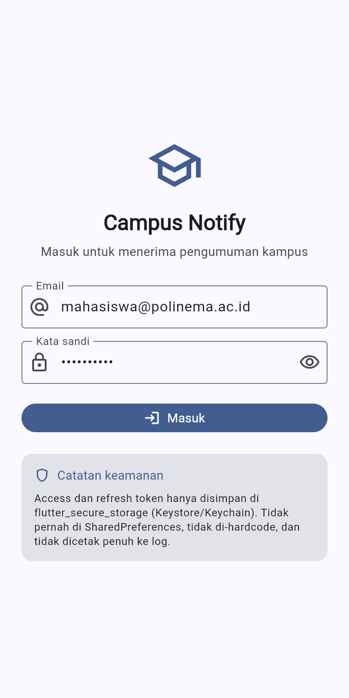

### 2. Validasi form
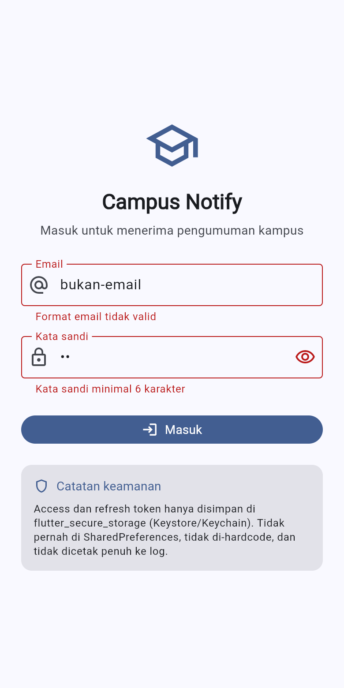

### 3. Beranda — Simulator FCM & pengumuman
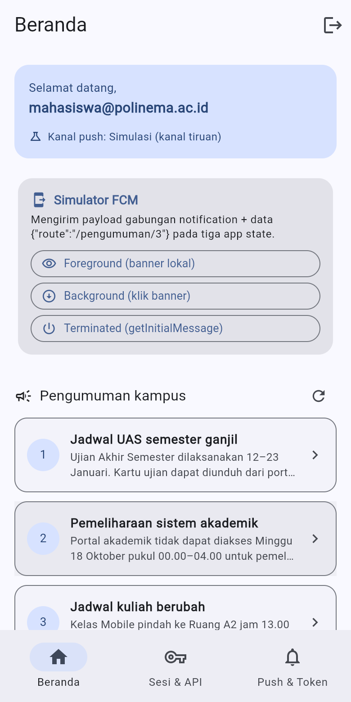

### 4. Token di secure storage (ditampilkan terpotong)
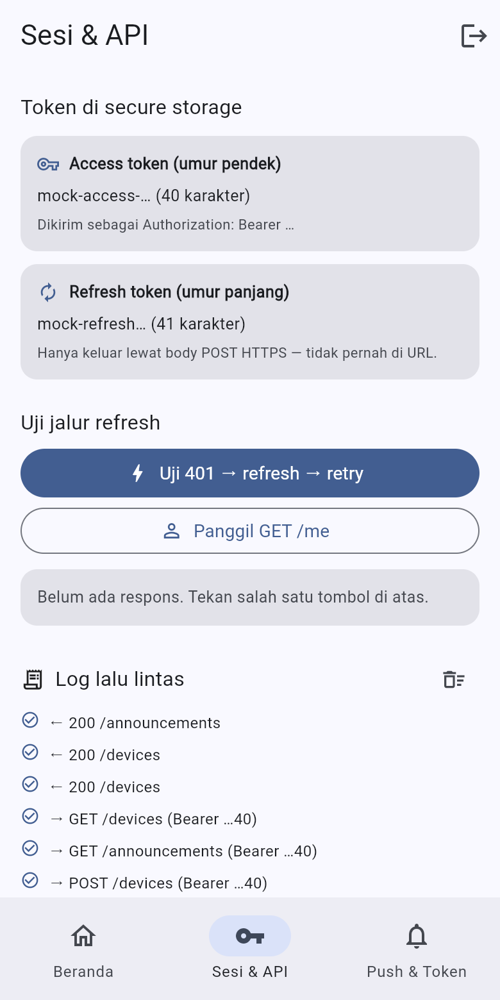

### 5. `401 → refresh → retry` — bukti jalur refresh otomatis
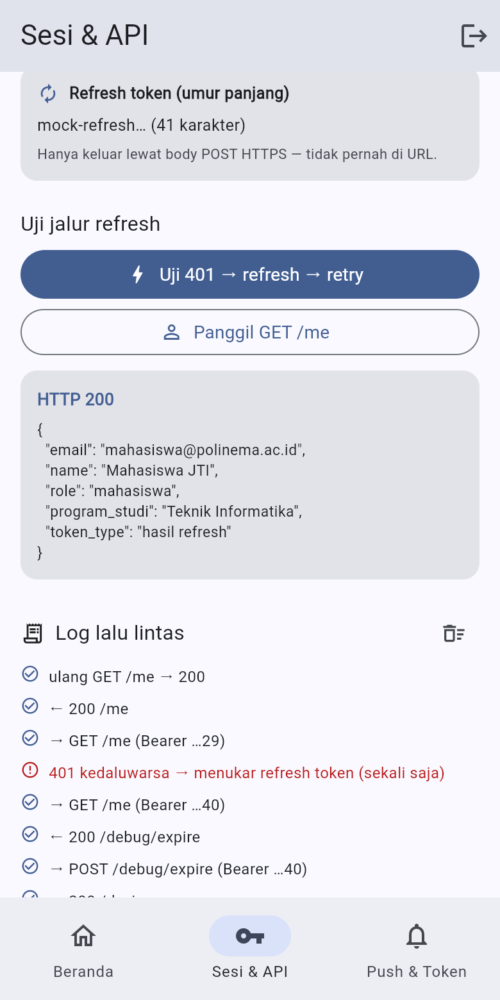

### 6. Push & Token — token terpotong, topik, jejak lifecycle
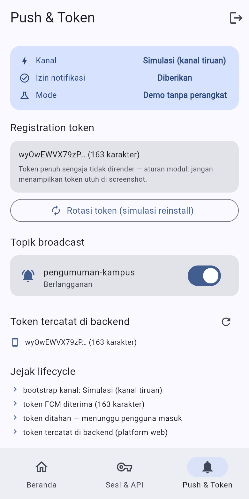

### 7. Foreground — banner lokal (sistem tidak menampilkannya sendiri)
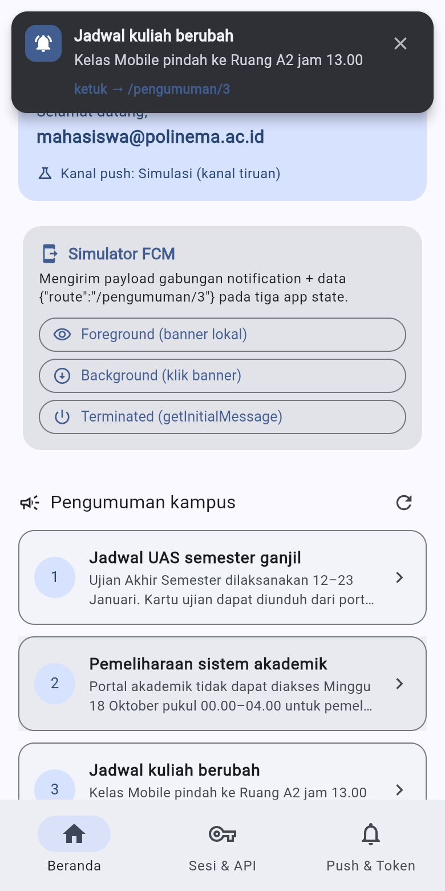

### 8. Background — klik banner masuk `/pengumuman/3`
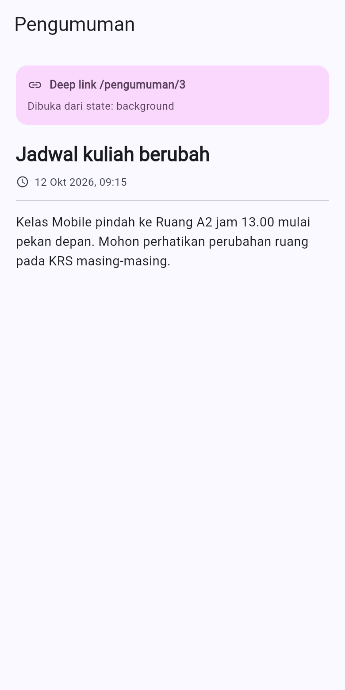

### 9. Terminated — `getInitialMessage` masuk rute yang sama
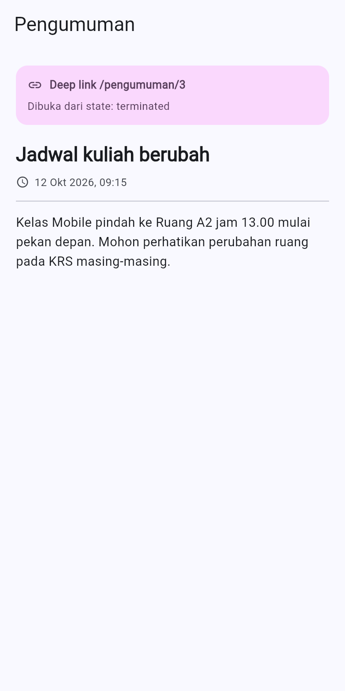

### 10. `onTokenRefresh` — token baru dikirim ulang ke backend
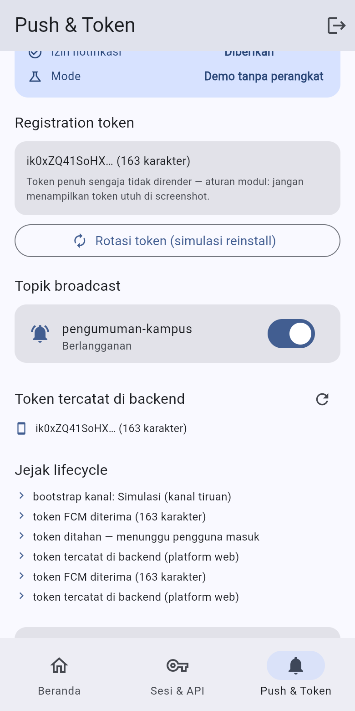

### 11. Keluar — seluruh token dihapus dari secure storage
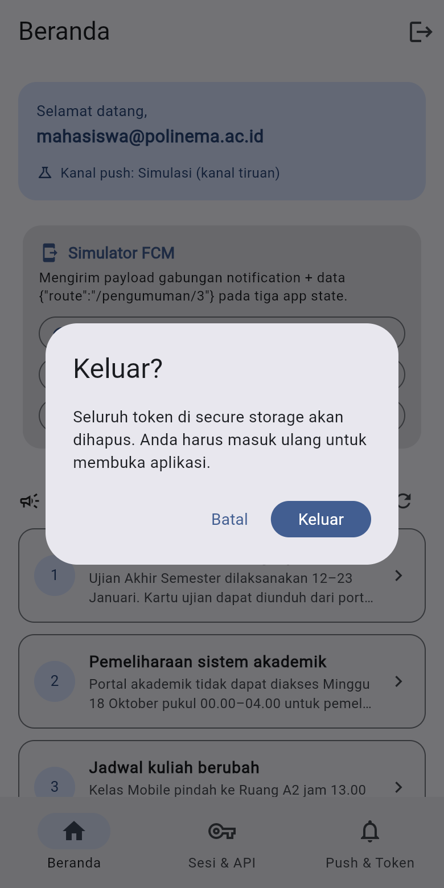

### 12. Deep link manual dari daftar pengumuman
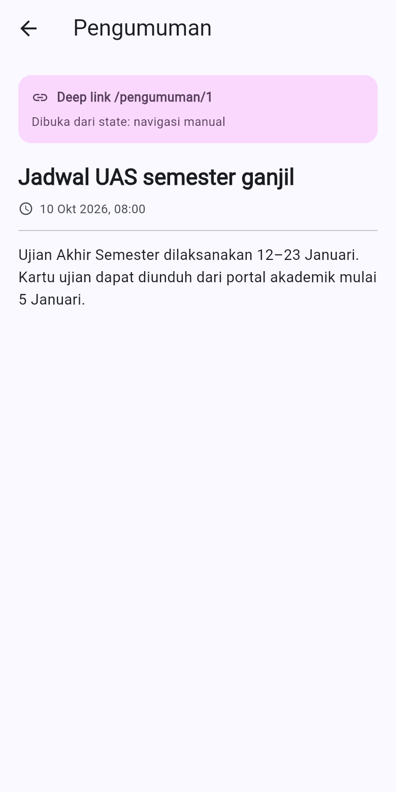

> `screenshots/fcm-console-test.png` (notifikasi sungguhan dari Firebase
> Console) **belum ada**: langkah itu butuh perangkat/emulator dengan Google
> Play Services dan project Firebase yang sudah didaftarkan. Langkahnya sudah
> disiapkan di [`docs/firebase_setup.md`](docs/firebase_setup.md) §5.

---

## 8. Tabel pengujian tiga app state (wajib modul)

Payload yang dipakai identik pada ketiga baris:
`notification {title, body}` + `data {route: "/pengumuman/3", id: "3"}`.

| State | Yang diharapkan | Cara uji | Hasil | Bukti |
|---|---|---|---|---|
| **Foreground** | Sistem **tidak** menampilkan banner otomatis → banner lokal muncul; ketuk masuk `/pengumuman/3` | Aplikasi terbuka, tekan **Foreground** di panel Simulator FCM (atau kirim dari Firebase Console) | Banner lokal muncul berisi judul, isi, dan `ketuk → /pengumuman/3` | [`07_push_foreground.png`](screenshots/07_push_foreground.png) |
| **Background** | Banner sistem muncul; ketuk membuka rute yang benar lewat `onMessageOpenedApp` | Tekan **Background (klik banner)**, setara minimize lalu klik banner | Masuk `/pengumuman/3`, halaman menandai `Dibuka dari state: background` | [`08_push_background_deeplink.png`](screenshots/08_push_background_deeplink.png) |
| **Terminated** | Aplikasi dibuka ke rute yang benar lewat `getInitialMessage()` | Tekan **Terminated (getInitialMessage)** | Masuk `/pengumuman/3`, halaman menandai `Dibuka dari state: terminated` | [`09_push_terminated_deeplink.png`](screenshots/09_push_terminated_deeplink.png) |

Yang penting dari tabel ini: **ketiga state masuk ke rute yang sama**. Kalau
`data.route` hilang, ketiganya mendarat di beranda — bug klasik "klik notifikasi
nyasar" yang tidak terlihat dari membaca kode.

Detail tambahan (termasuk cara menguji dengan Firebase Console sungguhan):
[`docs/three_app_states.md`](docs/three_app_states.md).

---

## 9. Pengujian

```bash
flutter test     # 35 test, semua lulus
```

| Berkas | Yang dibuktikan |
|---|---|
| `test/push_routing_test.dart` | **Refactoring 2** — fungsi murni `routeFromMessage`: payload kosong, `null`, spasi, garis miring hilang, nilai non-string, dan `announcementIdFromMessage` |
| `test/auth_session_test.dart` | logika sesi: validasi login, refresh token sah/palsu/kosong, batas nonce 32-bit, masking token, pemetaan `DioException → pesan ramah` |
| `test/api_refresh_interceptor_test.dart` | **inti Minggu 6**: 401 → refresh → retry → 200; 401 kedua **berhenti** (tanpa loop); refresh gagal → sesi dibersihkan; 401 tanpa refresh token → tidak mencoba refresh; respons 200 tidak menyentuh jalur refresh |
| `test/simulated_push_service_test.dart` | token awal & token hasil rotasi benar-benar dikirim ke backend; langganan/berhenti topik; ketiga app state tersalur lewat jalur yang sama |

Semuanya berjalan **tanpa Firebase dan tanpa jaringan sungguhan** — adapter Dio
diganti skenario naskah, dan penyimpanan rahasia diganti penyimpanan dalam
memori. Detail: [`docs/testing.md`](docs/testing.md).

Kontrak backend diperiksa terpisah dari Flutter:

```
node tool/check_api_flow.js
→ SEMUA PEMERIKSAAN LULUS   (login → 200 → expire → 401 → refresh → 200)
```

---

## 10. Refactoring Challenge (tiga-duanya wajib)

Detail dan alasan: [`docs/refactoring.md`](docs/refactoring.md).

1. **Semua string rute pindah ke `lib/routes.dart`** — deep link dari FCM dan
   definisi GoRouter memakai konstanta yang sama, sehingga tidak ada lagi rute
   "nyasar" yang hanya berbeda satu garis miring.
2. **Parsing `RemoteMessage → route` menjadi fungsi murni**
   `routeFromMessage(Map<String, dynamic>)` di `lib/messaging/push_message.dart`
   — bisa diunit-test tanpa Firebase, dan memang diuji 10 kali.
3. **Pemetaan `DioException → pesan ramah` pindah ke `lib/data/api_errors.dart`**
   — UI hanya menerima pesan siap tampil, bukan exception mentah.

---

## 11. AI Challenge

Prompt, keluaran awal AI, tabel usulan-vs-keputusan, dan checklist verifikasi
modul ada di [`docs/AI_challenge/`](docs/AI_challenge/README.md).

Ringkasan yang **menyimpang** dari usulan AI:

| Usulan AI | Keputusan final | Alasan |
|---|---|---|
| Interceptor memakai `dio.fetch(e.requestOptions)` tanpa penanda | Tambah penanda `extra['campus_notify_retried']` | Tanpa penanda, 401 kedua memicu refresh lagi → **loop tak berujung**. Diuji di `api_refresh_interceptor_test.dart` |
| Ganti access token lewat `store.save(access:, refresh:)` | Method terpisah `store.saveAccess()` | `save()` menulis ulang refresh token dari variabel lokal; kalau refresh token berubah di jalur lain, nilai basi menimpa yang baru |
| Simpan refresh token di `SharedPreferences` "agar mudah" | Tetap `flutter_secure_storage` | SharedPreferences tidak terenkripsi; token bisa disalin dari perangkat root/backup/ADB |
| `Random().nextInt(1 << 32)` untuk nonce token | `nextInt(2147483647)` (literal 2³¹−1) | **Bug nyata yang ditemukan saat uji web**: `1 << 32` menjadi `0` di dart2js sehingga `nextInt` melempar `RangeError` tepat pada jalur refresh — pengguna tiba-tiba dilempar ke `/login` |
| Tampilkan token penuh di halaman debug | Hanya 12 karakter pertama + jumlah karakter | Aturan modul: token tidak boleh utuh di screenshot |
| Firebase wajib ada agar aplikasi jalan | Firebase **opsional**; gagal → kanal tiruan | Modul mengakui FCM paling mudah diuji di perangkat fisik; tanpa jalur cadangan, aplikasi tidak bisa didemokan/difoto sama sekali |

---

## 12. Prinsip keamanan yang diterapkan

| Aturan | Wujudnya di kode |
|---|---|
| Token tidak pernah di SharedPreferences | `TokenStore` hanya memakai `flutter_secure_storage` (Keystore/Keychain) |
| Token tidak di-hardcode | Tidak ada literal token di `lib/`; hanya pola `mock-*` pada repository mock |
| Token tidak dicatat penuh | `TokenStore.mask()` dipakai di semua tempat; log interceptor hanya menyebut **panjang** token |
| Refresh token hanya lewat body POST HTTPS | Tidak pernah muncul di query string/URL; mock server hanya menerimanya di body |
| Secret tidak masuk repo | `google-services.json` dan `GoogleService-Info.plist` di-`.gitignore` |
| Handler background tidak menyentuh UI | `firebaseMessagingBackgroundHandler` top-level + `@pragma('vm:entry-point')`, tanpa `BuildContext`/Riverpod |
| Sesi mati tidak membiarkan UI menggantung | `onSessionExpired` → `forceLogout()` → guard GoRouter mengarahkan ke `/login` |

---

## 13. Refleksi

1. **Mengapa refresh token tidak boleh disimpan di SharedPreferences? Apa
   risikonya bila bocor?**
   SharedPreferences menyimpan data sebagai berkas/plist **tanpa enkripsi**.
   Siapa pun yang bisa membaca sandbox aplikasi — perangkat root/jailbreak,
   backup tidak terenkripsi, atau ADB di perangkat debug — dapat menyalin
   refresh token. Karena refresh token berumur panjang (simulasi 7 hari), token
   yang bocor bisa dipakai membuat access token baru **tanpa kata sandi dan
   tanpa perangkat asli**, dan pemilik akun tidak melihat apa pun di layar.
   `flutter_secure_storage` memakai Keychain (iOS) dan Keystore/EncryptedShared
   Preferences (Android) yang kuncinya dipegang sistem operasi.

2. **Apa yang rusak bila `onTokenRefresh` diabaikan selama satu semester?**
   Registration token berubah saat reinstall, hapus data, pemulihan backup, atau
   rotasi keamanan FCM. Tanpa listener, backend menyimpan token basi dan FCM
   membalas `UNREGISTERED`; notifikasi berhenti terkirim **tanpa error apa pun
   di sisi aplikasi** — pengguna mengira aplikasi rusak, pengembang tidak
   melihat gejala. Karena itu halaman *Push & Token* menampilkan token yang
   tercatat di backend, bukan hanya token di perangkat: perbedaannya langsung
   terlihat setelah rotasi.

3. **Kapan memakai topik, kapan memakai token perangkat?**
   Topik untuk **broadcast** ke banyak pengguna dengan isi yang sama: semua
   mahasiswa (`pengumuman-kampus`), satu kelas, satu UKM. Token perangkat untuk
   **pesan personal** yang tidak boleh dibaca orang lain: nilai ujian, tagihan
   UKT, peringatan akademik. Mengirim pesan personal lewat topik sama dengan
   menyiarkannya ke seluruh pelanggan topik itu.

4. **Bagian mana dari draf AI yang ditolak atau diperbaiki, dan mengapa?**
   Enam baris pada tabel §11. Yang paling penting dua: penanda anti-loop pada
   interceptor (tanpa itu 401 kedua memicu refresh lagi — bug yang hanya
   terlihat saat diuji, bukan saat dibaca), dan `nextInt(1 << 32)` yang menjadi
   `0` di web sehingga jalur refresh selalu gagal di sana. Keduanya ditemukan
   lewat pengujian, bukan lewat membaca ulang kode.

---

## 14. Error umum & solusi

| Gejala | Penyebab | Solusi |
|---|---|---|
| Token `null` / notifikasi tidak sampai di emulator | Emulator tanpa Google Play Services | Pakai emulator berikon Play Store atau perangkat fisik |
| Banner tidak muncul saat foreground | Mengandalkan banner otomatis sistem | Tampilkan manual lewat `flutter_local_notifications` di `onMessage` — sudah dilakukan di `NotificationPresenter.show()` |
| Klik notifikasi tidak navigasi saat terminated | `getInitialMessage()` tidak dipanggil saat startup | Panggil setelah router siap, teruskan `data.route` (lihat `FirebasePushService.start()` langkah 5) |
| 401 berulang meski sudah login | Interceptor mengulang request tanpa penanda, atau refresh ikut kedaluwarsa | Ulangi **sekali** dengan penanda `extra`, lalu `clear()` + arahkan ke `/login` |
| Pengguna tiba-tiba kembali ke `/login` tanpa sebab | Jalur refresh gagal — pernah terjadi karena `nextInt(1 << 32)` = `0` di web | Lihat pesan error di log lalu lintas; batasi nilai acak ke rentang aman |
| `MissingPluginException` (secure storage / messaging) | Hot reload setelah menambah plugin | Hentikan penuh lalu `flutter run` ulang |
| `google-services.json is missing` saat build | Plugin Google Services di-apply tanpa berkasnya | Berkas ini **hanya** di-apply bila `google-services.json` ada — taruh berkasnya, atau biarkan aplikasi memakai kanal tiruan |
| Notifikasi iOS tidak muncul | Belum ada APNs key / capability Push | Konfigurasi APNs di Firebase Console + aktifkan Push di Xcode ([`docs/firebase_setup.md`](docs/firebase_setup.md) §4) |
| `flutter_local_notifications` gagal kompilasi | Core library desugaring belum aktif | `isCoreLibraryDesugaringEnabled = true` + `coreLibraryDesugaring(...)` — sudah diset di `android/app/build.gradle.kts` |

---

## 15. Checklist verifikasi mandiri

- [x] Token hanya di `flutter_secure_storage`; tidak ada SharedPreferences, tidak
      di-hardcode, tidak dicetak penuh (bukti: `04_sesi_token.png`,
      `06_push_token.png`, `10_rotate_token.png`).
- [x] 401 memicu refresh **sekali** lalu retry; refresh mati memaksa login ulang
      (bukti: `05_api_401_refresh.png` + `test/api_refresh_interceptor_test.dart`).
- [x] Ketiga app state teruji dengan tabel bukti; klik masuk ke rute yang benar
      (`07`–`09`).
- [x] Topik untuk broadcast (`pengumuman-kampus`), token untuk pesan personal
      (dokumentasi `POST /devices`).
- [x] `flutter analyze` bersih dan 35 test lulus
      (`docs/verification/flutter_analyze.txt`, `flutter_test.txt`).
- [x] Tiga Refactoring Challenge dikerjakan (`lib/routes.dart`,
      `routeFromMessage`, `lib/data/api_errors.dart`).
- [x] AI Challenge didokumentasikan (prompt, keluaran awal, perbaikan manual,
      alasan teknis) di `docs/AI_challenge/`.
- [ ] `screenshots/fcm-console-test.png` — **butuh Firebase project +
      perangkat fisik**; langkahnya sudah disiapkan di
      [`docs/firebase_setup.md`](docs/firebase_setup.md) §5.

---

## 16. Referensi

- [Modul Week 6 — Authentication, Security & FCM](https://jti-polinema.github.io/flutter-codelab/06-minggu-6-authentication-security-fcm/index.html)
- [FCM Flutter client (setup & token)](https://firebase.google.com/docs/cloud-messaging/flutter/client)
- [FCM message types: notification vs data](https://firebase.google.com/docs/cloud-messaging/concept-options)
- [Firebase Auth for Flutter](https://firebase.google.com/docs/auth/flutter/start)
- [flutter_secure_storage](https://pub.dev/packages/flutter_secure_storage)
- [flutter_local_notifications](https://pub.dev/packages/flutter_local_notifications)
- [GoRouter: redirect & deep linking](https://go_router.dev/)
- [OWASP Mobile Top 10](https://owasp.org/www-project-mobile-top-10/)
