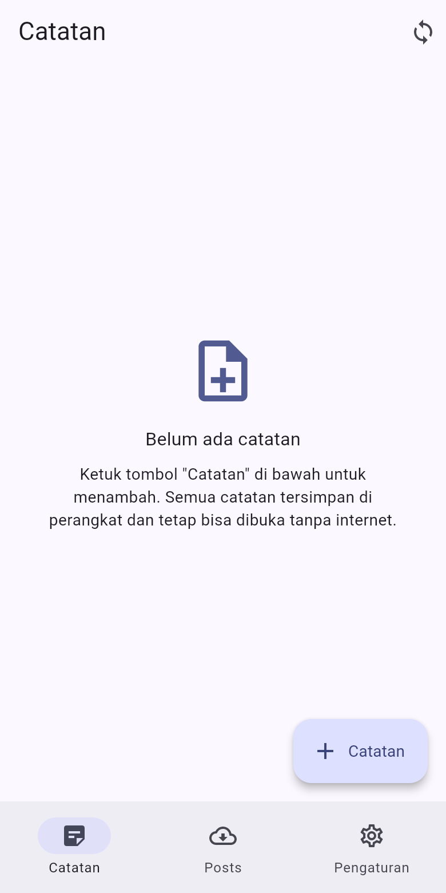
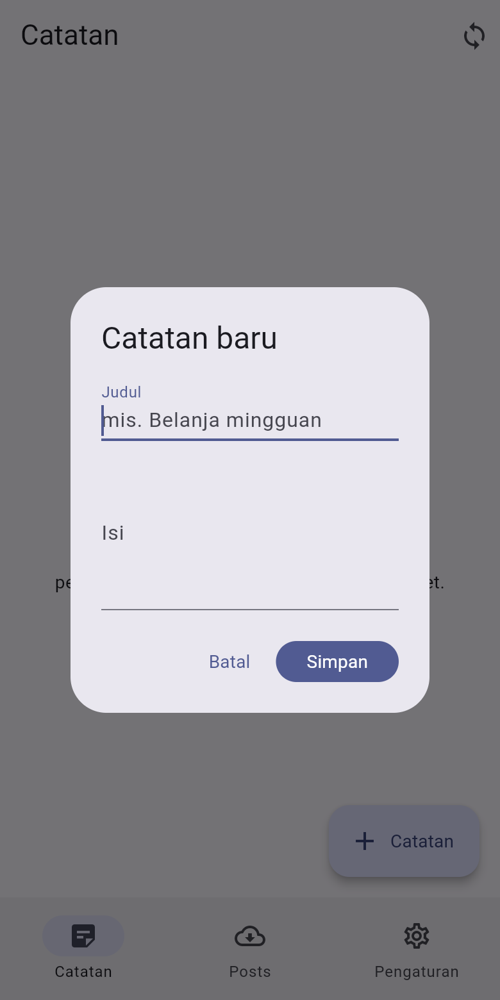
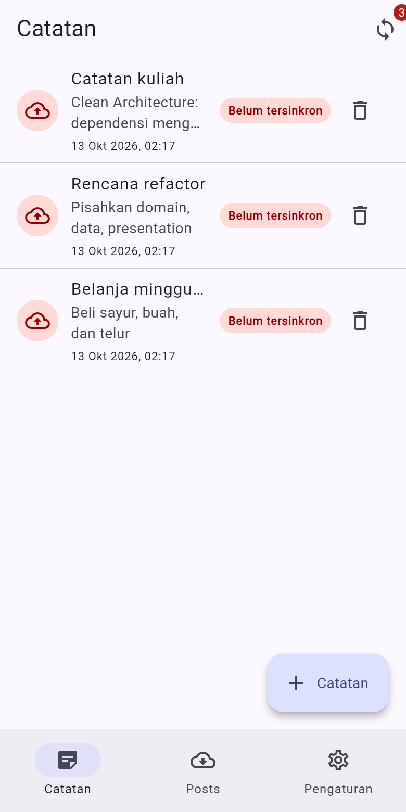
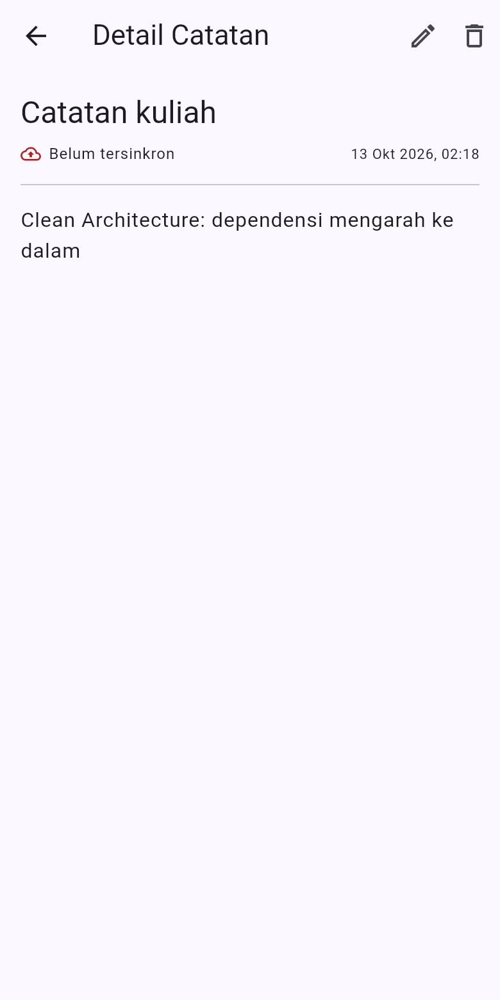
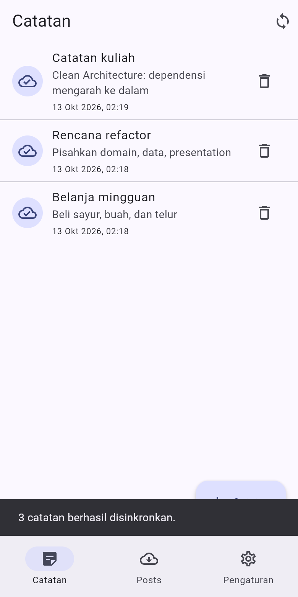
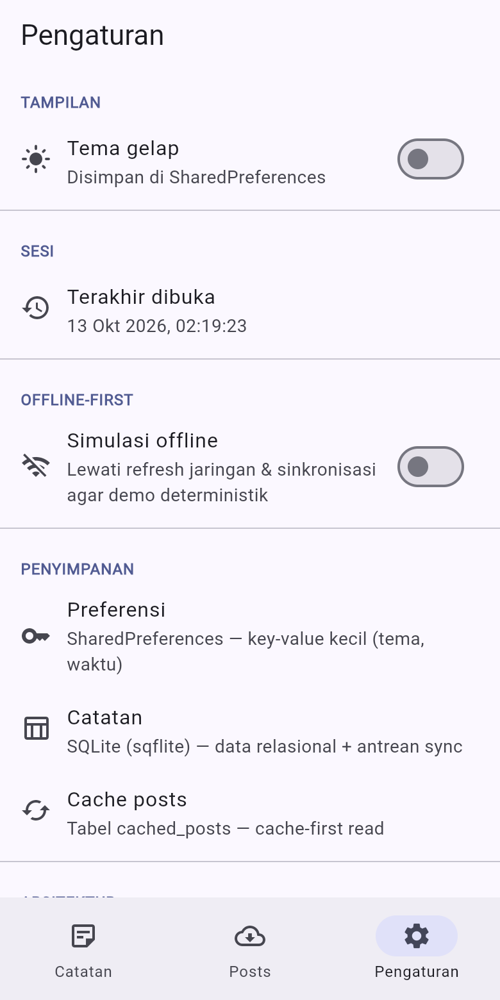
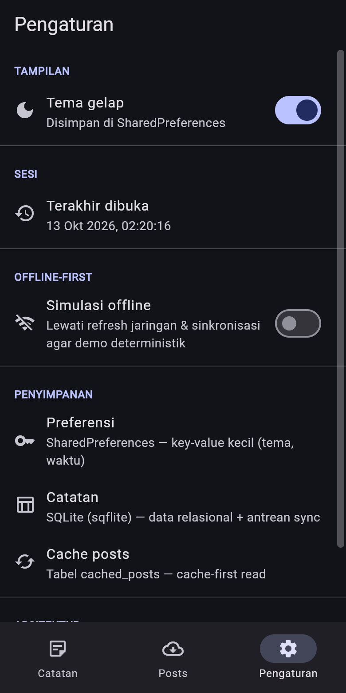
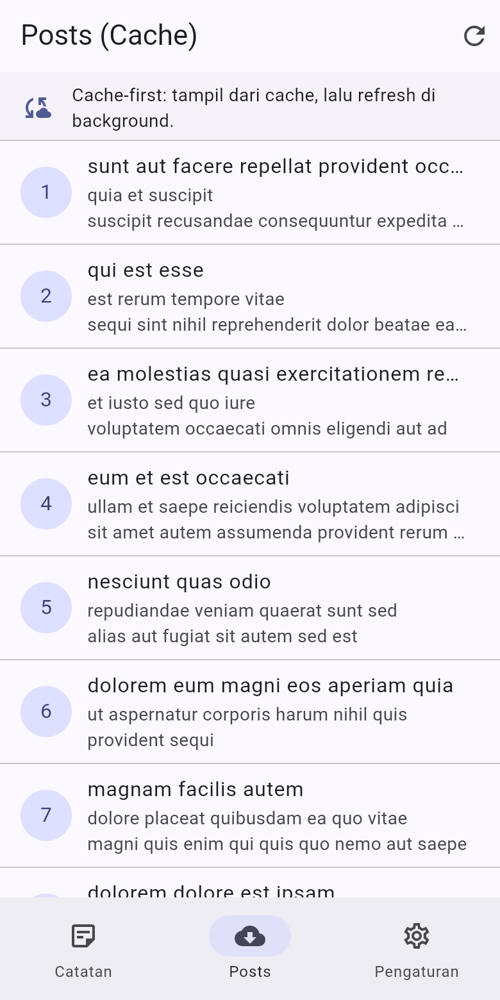
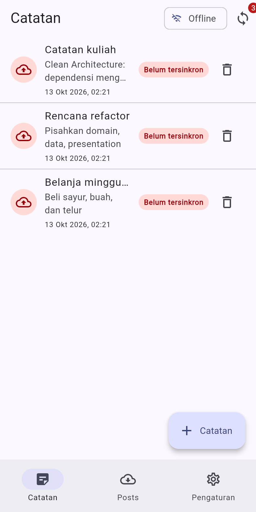
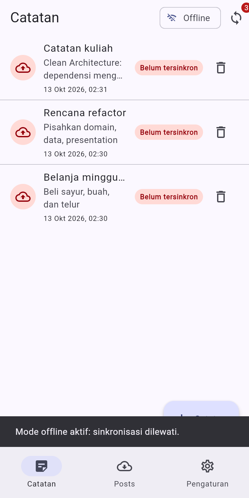

# Week 7 — Clean Architecture (Clean Notes)

Refactor project **Minggu 5 (`week5_offline_notes`)** menjadi struktur
**Clean Architecture feature-first**. Aplikasi tidak dibuat dari nol: kode yang
sudah jalan dipindahkan, dipecah, dan diputus dependensi terlarangnya.

Yang dinilai pada minggu ini bukan kerapian folder, melainkan **arah panah
dependensi**: `presentation → domain ← data`, dengan `domain` yang benar-benar
steril dari Flutter, Dio, SQLite, dan Firebase.

> Perilaku aplikasi **identik** dengan Minggu 5 (CRUD catatan SQLite, antrean
> sync `dirty`, cache-first posts, preferensi tema). Yang berubah hanya
> strukturnya — bukti screenshot before/after ada di bawah.

---

## 1. Tujuan pembelajaran

- Menjelaskan prinsip **SOLID** dan *separation of concerns* lewat kode Flutter.
- Membedakan **feature-first** vs **layer-first** beserta trade-off-nya.
- Menjelaskan tiga layer (**presentation, domain, data**) dan **dependency rule**.
- Membedakan **entity vs model** serta peran **repository, use case, dan DI**.
- Merefactor project Minggu 5 menjadi struktur feature-first yang terpisah layer-nya.
- Menguji use case dengan **repository palsu** tanpa database atau jaringan sungguhan.

---

## 2. Diagram layer dan arah dependensi

```
                       bergantung ke
  presentation  ───────────────────────►  domain
  (widget, page,                          (entity, repository
   notifier, router)                       interface, use case,
                                           failure)
                                                ▲
                                                │ diimplementasikan oleh
                                                │ (mengarah ke DALAM)
  data  ────────────────────────────────────────┘
  (model, datasource, repository impl,
   Dio, SQLite, SharedPreferences)
```

**Dependency rule:** dependensi hanya mengarah ke dalam.
`domain` tidak mengimpor apa pun dari luar `dart:core`. Karena itu logika bisnis
(`GetNotes`, `SyncNotes`) bisa diuji murni tanpa SQLite, Dio, atau Firebase.

Konsekuensi praktisnya:

| Aturan | Alasan |
|---|---|
| Interface repository di `domain`, implementasi di `data` | `domain` mendefinisikan kebutuhan; `data` menyediakan caranya. Bila dibalik, `domain` harus mengimpor `data` → panah terbalik dan logika bisnis terkunci pada SQLite |
| Mapping (`toMap/fromMap/fromJson`) hanya di `data/models` | Bentuk penyimpanan bisa berubah tanpa menyentuh entity |
| Wiring DI hanya di provider | Widget tidak pernah `new Repository()`; dependensi mudah diganti fake saat test |
| Widget tidak menyentuh jaringan/DB | UI hanya menerima `message` dari `Failure`, bukan `DatabaseException` |

---

## 3. Fitur utama

1. **CRUD catatan (SQLite)** — daftar urut `updated_at DESC`, lewat kontrak
   `NoteRepository` di domain.
2. **Antrean sync + dirty flag** — perubahan lokal menandai `dirty = 1`;
   `SyncNotes` mengirim antrean lalu menandai bersih **hanya setelah sukses**.
3. **Cache-first read (posts)** — cache lokal ditampilkan seketika, lalu
   di-refresh dari jaringan di background.
4. **Preferensi (SharedPreferences)** — tema gelap/terang dan waktu terakhir
   dibuka, dipisah ke fitur `settings` sendiri.
5. **Empat state UI** — loading, error (+ retry), empty, success.
6. **Simulasi offline deterministik** — toggle agar demo tidak bergantung Wi-Fi.
7. **Halaman detail `/note/:id`** (GoRouter) — membaca dari repository, bukan
   dioper dari state halaman list.
8. **`Failure` ramah pengguna** — exception platform diterjemahkan di layer data.
9. **Formatting murni** di `lib/core/format.dart` — bisa diuji tanpa widget.
10. **27 test lulus** — use case, model, fungsi murni, repository, dan widget.

---

## 4. Struktur folder

```
lib/
├── core/                                  # MURNI Dart (tanpa Flutter/Dio/SQLite)
│   ├── failures.dart                      #   Failure: Local/Network/Offline
│   └── format.dart                        #   formatting tanggal + parsing rute
├── shared/
│   └── data/                              # infrastruktur lintas fitur (framework OK)
│       ├── local/app_database.dart        #   pembuka SQLite terpusat
│       ├── local/db_factory_*.dart        #   factory per platform (conditional import)
│       └── network/api_client.dart        #   klien Dio terpusat
├── features/
│   ├── home/presentation/pages/home_shell_page.dart   # NavigationBar (shell, bukan domain)
│   ├── notes/                             # FITUR 1 — domain penuh
│   │   ├── domain/
│   │   │   ├── entities/note.dart
│   │   │   ├── repositories/note_repository.dart      # interface!
│   │   │   └── usecases/{get_notes,sync_notes}.dart
│   │   ├── data/
│   │   │   ├── models/note_model.dart
│   │   │   ├── datasources/notes_local_datasource.dart
│   │   │   └── repositories/note_repository_impl.dart
│   │   └── presentation/
│   │       ├── providers/notes_providers.dart         # notifier + DI
│   │       ├── pages/{notes_page,note_detail_page}.dart
│   │       └── widgets/{note_tile,note_editor_dialog}.dart
│   ├── posts/                             # FITUR 2 — domain penuh
│   │   ├── domain/{entities,repositories}/
│   │   ├── data/{models,datasources,repositories}/
│   │   └── presentation/{providers,pages}/
│   └── settings/                          # FITUR 3 — domain penuh
│       ├── domain/{entities,repositories}/
│       ├── data/{datasources,repositories}/
│       └── presentation/{providers,pages}/
├── routes.dart                            # GoRouter + konstanta rute
└── main.dart                              # bootstrap: container + MaterialApp.router
```

Struktur ini **feature-first**: satu fitur bisa dipahami, diuji, bahkan dihapus
tanpa menyentuh fitur lain. Fitur berkomunikasi lewat provider atau rute, bukan
dengan saling mengimpor widget.

---

## 5. Pemetaan file lama (Minggu 5) → layer baru

| File Minggu 5 | Layer saat itu | Masalah | Tujuan baru |
|---|---|---|---|
| `lib/pages/home_page.dart` | presentation | menyusun 3 halaman dalam satu file | `features/home/.../home_shell_page.dart` |
| `lib/pages/notes_page.dart` | presentation | memanggil `syncNotes()` bebas; formatting tanggal lokal | `features/notes/presentation/pages/notes_page.dart` (memanggil `SyncController` + `format.dart`) |
| `lib/pages/note_detail_page.dart` | presentation | `_formatTime()` privat di file halaman | pindah + pakai `core/format.dart` |
| `lib/pages/cached_posts_page.dart` | presentation | OK, hanya provider | `features/posts/presentation/pages/` |
| `lib/pages/settings_page.dart` | presentation | `_prettyTime()` privat | `features/settings/presentation/pages/` + `core/format.dart` |
| `lib/widgets/note_tile.dart` | presentation | `_formatTime()` privat | `features/notes/presentation/widgets/` |
| `lib/widgets/note_editor_dialog.dart` | presentation | menerima `WidgetRef` sebagai parameter | `features/notes/presentation/widgets/` (pakai `ConsumerStatefulWidget`) |
| `lib/data/local/note.dart` | data (+ entity tercampur) | entity **dan** `toMap/fromMap` dalam satu kelas | pecah: entity `domain/entities/note.dart` + model `data/models/note_model.dart` |
| `lib/data/repositories/note_repository.dart` | data (+ kontrak tercampur) | interface & implementasi satu kelas, tidak ada `Failure` | pecah: kontrak `domain/repositories/` + impl `data/repositories/` |
| `lib/data/providers.dart` | presentation (state) | satu file berisi **semua** fitur; mencampur `dioProvider`, notifier notes, posts, settings | pecah per fitur: `features/*/presentation/providers/` |
| `lib/data/sync.dart` | data | fungsi bebas `syncNotes()` berisi aturan bisnis; `readCachedPosts()`/`writeCachedPosts()` dipanggil langsung dari provider | aturan bisnis → use case `SyncNotes`; cache-first → `PostRepositoryImpl` |
| `lib/data/prefs.dart` | data | kelas konkret tanpa kontrak | kontrak `SettingsRepository` + impl + datasource |
| `lib/data/api_client.dart` | data | OK | `shared/data/network/api_client.dart` |
| `lib/data/local/db*.dart` | data | OK | `shared/data/local/` |
| `lib/data/models/post.dart` | data | model **sekaligus** entity (ada `fromJson/toJson` di satu kelas) | pecah: entity `Post` + model `PostModel` |
| `lib/app_router.dart` | presentation | parsing id di dalam `builder` | `routes.dart` + `core/format.dart#parseNoteId` |

### Tiga pelanggaran klasik yang ditemukan

| # | Gejala | Temuan di Minggu 5 | Perbaikan |
|---|---|---|---|
| 1 | Widget/notifier menyentuh jaringan/DB langsung | `data/providers.dart` memanggil `readCachedPosts()` & `fetchPostsFromNetwork()` langsung | semua lewat `PostRepository` (domain) |
| 2 | Logika bisnis/formatting di dalam widget | `_formatTime()` dan `_prettyTime()` privat di 3 file halaman | `core/format.dart` (fungsi murni, teruji) |
| 3 | Instansiasi manual / DI bocor | `SyncController` memanggil fungsi bebas `syncNotes(repo, ...)` yang berisi aturan bisnis | use case `SyncNotes` disuntik lewat `syncNotesProvider` |

---

## 6. Stack teknologi

| Kebutuhan | Package |
|---|---|
| State management + DI | `flutter_riverpod` 3.x |
| Navigasi | `go_router` 18.x |
| Jaringan | `dio` 5.x |
| Database lokal | `sqflite` + `sqflite_common_ffi` (desktop) + `sqflite_common_ffi_web` (web) |
| Preferensi | `shared_preferences` |
| Formatting | `intl` |
| Lint | `flutter_lints` |

---

## 7. Cara menjalankan

```bash
cd 07-week-7-clean-architecture/week7_clean_notes
flutter pub get

# Target utama codelab (Android)
flutter run

# Analisis statis + test
flutter analyze
flutter test

# Verifikasi dependency rule (tiga grep pada modul)
powershell -ExecutionPolicy Bypass -File tool/check_dependency_rule.ps1
```

Menjalankan di browser (dipakai untuk dokumentasi screenshot):

```bash
dart run sqflite_common_ffi_web:setup     # sekali saja
flutter run -d chrome
```

---

## 8. Hasil / Screenshot

Screenshot diambil satu per satu pada **layout mobile** (viewport 390×780,
DPR 2) dari aplikasi yang benar-benar berjalan.

| # | Layar | Berkas |
|---|---|---|
| 1 | Empty state | [`screenshots/01_empty.png`](screenshots/01_empty.png) |
| 2 | Dialog catatan baru | [`screenshots/02_add_dialog.png`](screenshots/02_add_dialog.png) |
| 3 | Daftar catatan — 3 catatan `dirty` | [`screenshots/03_list_dirty.png`](screenshots/03_list_dirty.png) |
| 4 | Detail `/note/:id` | [`screenshots/04_detail.png`](screenshots/04_detail.png) |
| 5 | Setelah sync — badge hilang | [`screenshots/05_after_sync.png`](screenshots/05_after_sync.png) |
| 6 | Pengaturan | [`screenshots/06_settings.png`](screenshots/06_settings.png) |
| 7 | Tema gelap (persist) | [`screenshots/07_settings_dark.png`](screenshots/07_settings_dark.png) |
| 8 | Posts — cache-first read | [`screenshots/08_posts_cached.png`](screenshots/08_posts_cached.png) |
| 9 | Mode offline aktif | [`screenshots/09_offline.png`](screenshots/09_offline.png) |
| 10 | Sync ditolak saat offline (`OfflineFailure`) | [`screenshots/10_offline_sync.png`](screenshots/10_offline_sync.png) |

### 1. Empty state


### 2. Dialog catatan baru


### 3. Daftar catatan — tiga catatan belum tersinkron


### 4. Detail catatan


### 5. Setelah sinkronisasi — badge hilang, antrean nol


### 6. Pengaturan


### 7. Tema gelap — preferensi persist di SharedPreferences


### 8. Posts — cache-first read


### 9. Simulasi offline aktif — catatan tetap terbaca


### 10. Sinkronisasi ditolak saat offline


### Before / After (UI sama, struktur beda)

Screenshot "before" diambil dari project Minggu 5 yang tidak diubah
(`week5_offline_notes/screenshots/`), sehingga perbandingan dilakukan pada
aplikasi yang benar-benar berjalan, bukan mockup.

| Fitur | Before — Minggu 5 | After — Minggu 7 |
|---|---|---|
| Empty state |  |  |
| Daftar dirty |  |  |
| Detail catatan |  |  |
| Setelah sync |  |  |
| Pengaturan |  |  |
| Posts cache |  |  |

Cara pengambilan screenshot (satu per satu, tutup, lalu ganti berikutnya)
didokumentasikan di [`docs/screenshots.md`](docs/screenshots.md).

---

## 9. Pengujian

```bash
flutter test     # 27 test, semua lulus
```

| Berkas | Yang dibuktikan |
|---|---|
| `test/get_notes_test.dart` | use case `GetNotes` sukses + meneruskan `Failure` **tanpa melempar**, memakai repository palsu (tanpa SQLite) |
| `test/sync_notes_test.dart` | aturan bisnis `SyncNotes`: antrean kosong, upload sukses, mode offline, upload gagal (catatan tetap kotor) |
| `test/note_model_test.dart` | mapping **hanya** di model; entity tetap bersih; `.toEntity()` |
| `test/format_test.dart` | fungsi murni `formatDateTime`, `formatRelative`, `parseNoteId`, `parseIsoDate` |
| `test/post_repository_impl_test.dart` | aturan cache-first: baca cache, refresh sukses, refresh gagal tidak merusak cache |
| `test/note_tile_test.dart` | widget murni: badge `dirty` dan `onTap` |

Detail: [`docs/testing.md`](docs/testing.md).
Keluaran lengkap: [`docs/verification/flutter_test.txt`](docs/verification/flutter_test.txt).

---

## 10. Verifikasi dependency rule

Tiga pemeriksaan pada modul dijalankan ulang lewat skrip
[`tool/check_dependency_rule.ps1`](tool/check_dependency_rule.ps1):

```
# 1. Presentation steril dari data mentah
rg "Dio\(|openDatabase|getDatabasesPath|FlutterSecureStorage|SharedPreferences\.getInstance|jsonDecode" \
   lib/features/*/presentation lib/pages
   -> (NOL HASIL)

# 2. Domain & core steril dari framework/package
rg "import 'package:flutter|import 'package:dio|import 'package:sqflite|import 'package:firebase" \
   lib/features/*/domain lib/core
   -> (NOL HASIL)

# 3. UI tidak menginstansiasi repository/Dio sendiri
rg "RepositoryImpl\(|Repository\(|Dio\(BaseOptions" \
   lib/features/*/presentation/pages lib/features/*/presentation/widgets lib/pages
   -> (NOL HASIL)
```

Catatan jujur: modul menulis grep no. 3 sebagai
`rg "Repository\(|Dio\(BaseOptions" lib/pages lib/providers`. Pada struktur
feature-first tidak ada lagi folder `lib/providers`, dan **wiring DI memang
berada di `presentation/providers`** (contoh resmi modul pun menaruh
`NoteRepositoryImpl(openDb: openNotesDb)` di `notes_providers.dart`). Karena itu
grep no. 3 diarahkan ke `pages/` dan `widgets/` — tempat yang seharusnya bersih.
Alasannya ditulis di [`docs/AI_challenge/usulan_vs_keputusan.md`](docs/AI_challenge/usulan_vs_keputusan.md).

`flutter analyze`: **No issues found!**
Keluaran mentah: [`docs/verification/`](docs/verification/).

---

## 11. AI Challenge

Prompt, keluaran awal AI, tabel usulan-vs-keputusan-final, dan checklist
verifikasi ada di [`docs/AI_challenge/`](docs/AI_challenge/README.md).

Ringkasan keputusan yang **menyimpang** dari usulan AI:

| Usulan AI | Keputusan final | Alasan |
|---|---|---|
| Use case untuk setiap CRUD (`AddNote`, `DeleteNote`, `UpdateNote`) | Cukup repository langsung ke notifier; use case hanya `GetNotes` dan `SyncNotes` | Use case per operasi satu baris = over-engineering; lapisan tambahan tanpa aturan bisnis |
| `fpdart`/`dartz` (`Either<Failure, T>`) | *record* Dart `({hasil, Failure? failure})` | Mengikuti contoh modul, tanpa dependensi tambahan, tetap eksplisit sukses/gagal |
| `get_it` untuk DI | Riverpod provider saja | Riverpod sudah ada; dua sistem DI = dua sumber kebenaran |
| Entity `Note` tetap membawa `toMap/fromMap` | Mapping dipindah ke `NoteModel` | Entity di domain harus bebas detail penyimpanan |
| `core/api_client.dart` (Dio di `core/`) | `shared/data/network/api_client.dart` | `lib/core` wajib steril (grep no. 2) |
| Folder `domain/repositories` + `data/repositories` digabung | Dipisah | Interface di domain, implementasi di data — inti dependency rule |

---

## 12. Refactoring Challenge

Detail: [`docs/refactoring.md`](docs/refactoring.md).

1. **Fitur kedua (`posts`) dan ketiga (`settings`) ikut dibersihkan** — bukan
   hanya `notes`. Ketiganya punya entity + repository interface + impl +
   provider wiring sendiri.
2. **Formatting & parsing rute diekstrak** ke `lib/core/format.dart`
   (`formatDateTime`, `formatRelative`, `parseNoteId`, `parseIsoDate`) sehingga
   bisa diuji tanpa widget.
3. **Semua exception mentah menjadi `Failure`** di batas layer data
   (`LocalFailure`, `NetworkFailure`, `OfflineFailure`); UI hanya menerima
   `message` lewat `FailureException`.

---

## 13. Refleksi

1. **Mengapa interface repository harus tinggal di domain, bukan di data?**
   Karena `domain` yang membutuhkan operasi itu; `data` hanya menyediakan cara
   memenuhinya. Bila interface ditaruh di `data`, `domain` harus mengimpor `data`
   → panah dependensi terbalik, `domain` jadi tahu SQLite/Dio, dan use case tidak
   lagi bisa diuji tanpa database. Saat itu terjadi, "Clean Architecture" hanya
   jadi tata letak folder.

2. **Kapan use case benar-benar dibutuhkan?**
   Saat operasi menggabungkan lebih dari satu repository, atau memuat aturan
   bisnis/urutan langkah. `SyncNotes` adalah contohnya: hitung → tolak bila
   offline → upload → tandai bersih **hanya setelah sukses**. Untuk CRUD
   satu-baris, repository langsung ke notifier sudah cukup dan lebih jujur.

3. **Apa biaya over-engineering bagi tim kecil?**
   Setiap use case tambahan berarti satu file, satu test, dan satu titik yang
   harus diubah setiap kali kontrak berubah — tanpa nilai bisnis. Biaya itu
   sepadan ketika logika tumbuh (multi-sumber data, aturan konflik, audit), dan
   tidak sepadan untuk CRUD sederhana.

4. **Bagian usulan AI yang ditolak?**
   Use case per CRUD, `fpdart`, dan `get_it` (lihat tabel di atas). Yang
   diterima: pemisahan interface/implementasi dan penyatuan wiring DI di
   provider.

---

## 14. Error umum & solusi

| Gejala | Penyebab | Solusi |
|---|---|---|
| `The argument type 'NoteModel' can't be assigned to 'Note'` | Repository impl mengembalikan model, kontrak meminta entity | Konversi `.toEntity()` di batas data → domain |
| Import cycle | Feature saling mengimpor widget, atau `domain` mengimpor `data` | Fitur berkomunikasi lewat provider/rute; panah hanya presentation → domain ← data |
| `ref.watch` di luar widget/provider | Wiring DI ditulis di fungsi biasa | Wiring hanya di `Provider/Notifier` atau `ConsumerWidget` |
| Test butuh database sungguhan | Use case diuji dengan `NoteRepositoryImpl` asli | Uji domain selalu dengan fake yang mengimplementasikan interface |
| `MissingPluginException` (shared_preferences/sqflite) | Hot restart setelah menambah plugin | Hentikan aplikasi, `flutter run` ulang |
| Refactor merusak fitur yang sudah jalan | Tidak ada snapshot commit / uji manual | Commit snapshot dulu; setelah refactor uji tiap fitur ±5 menit dan bandingkan screenshot |
| `flutter build web` tanpa `sqlite3.wasm` | Setup web belum dijalankan | `dart run sqflite_common_ffi_web:setup` |

---

## 15. Checklist verifikasi mandiri

- [x] Tiga grep sterilitas nol hasil (`docs/verification/grep_sterilitas.txt`).
- [x] Interface repository di `domain`, implementasi di `data`, mapping hanya di model.
- [x] Widget tidak menginstansiasi repository; semua lewat provider.
- [x] Aplikasi berjalan sama seperti Minggu 5 (bukti screenshot).
- [x] `flutter analyze` bersih dan 27 test lulus.
